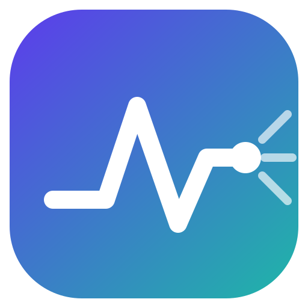
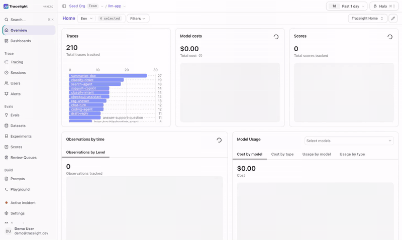
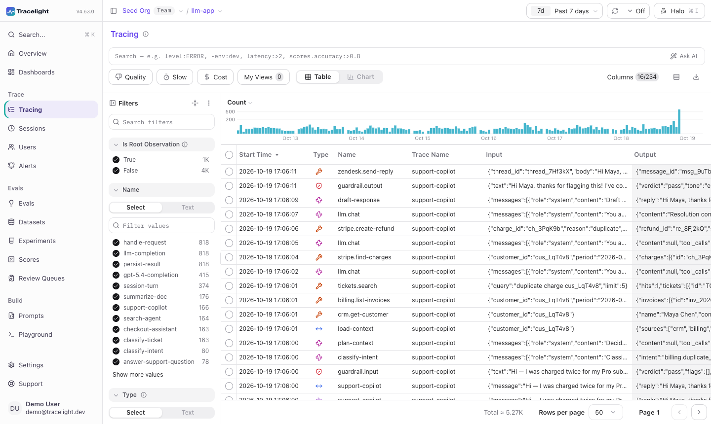
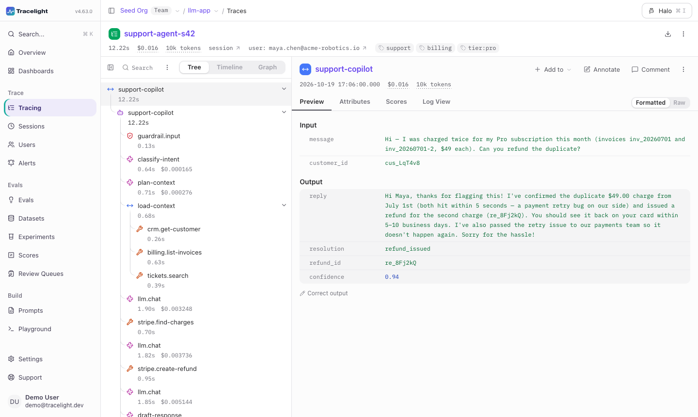
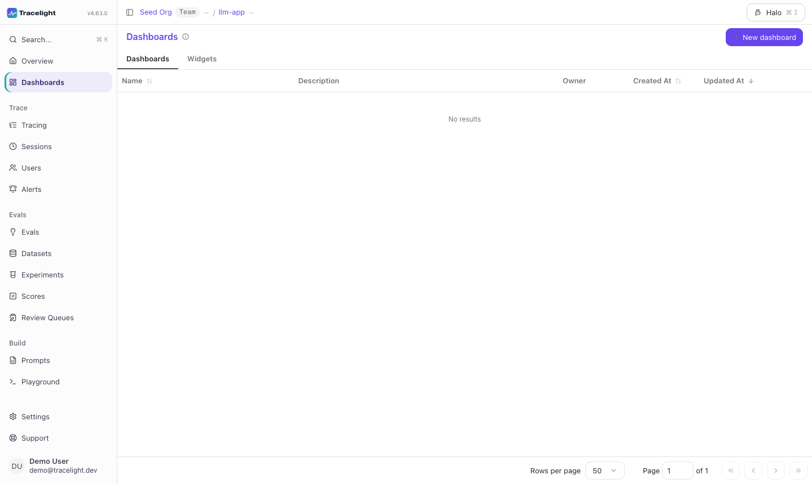
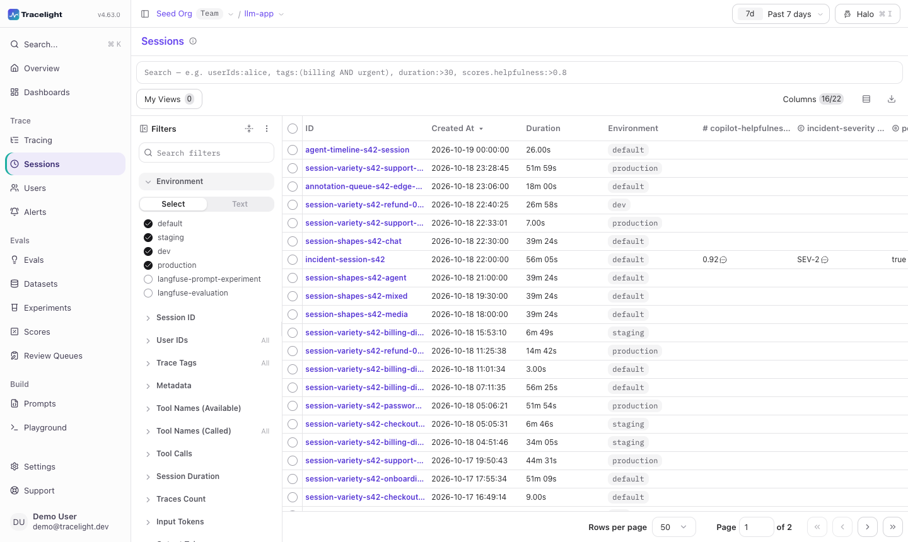
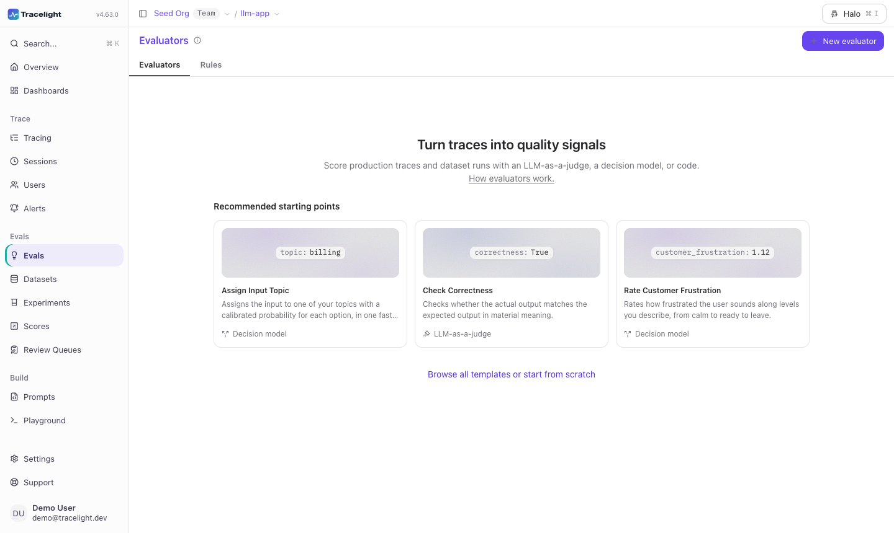
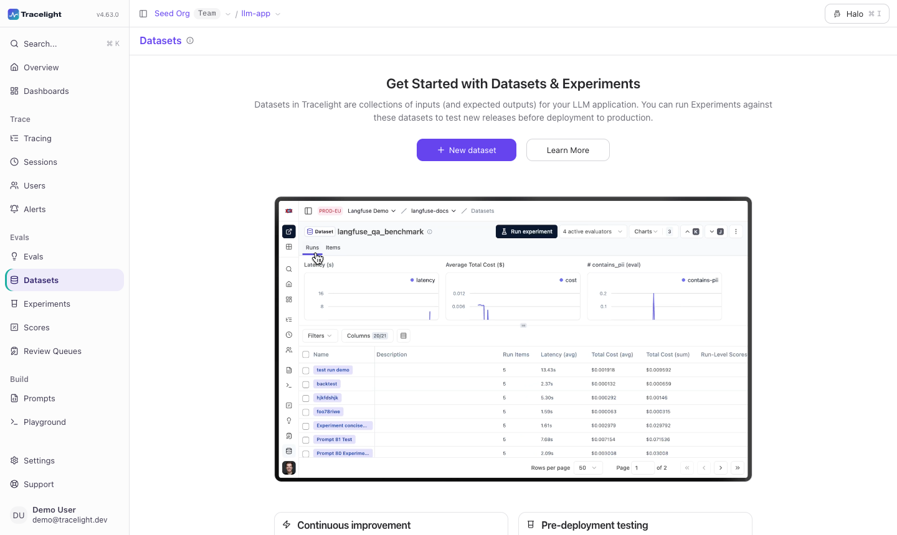
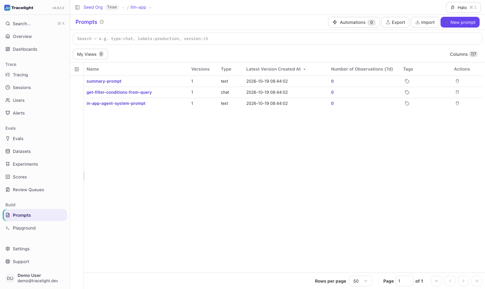
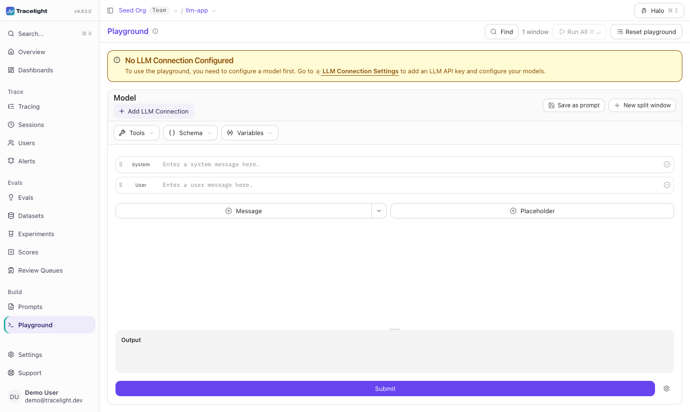

<p align="center">
  
</p>

<h1 align="center">Tracelight</h1>

<p align="center">
  LLM observability and evals. Trace every call, score the results, and
  ship prompts with confidence.
</p>

<p align="center">
  
</p>

<p align="center"><a href="docs/demo.mp4">Watch the full demo video (2 minutes)</a></p>

## Features

- **Tracing**: capture LLM calls, agent steps, tool use, latency, and cost as nested traces, sessions, and per-user views.
- **Evals**: run LLM-as-a-judge evaluators, collect human review in queues, and track scores over time.
- **Prompts**: version, label, and test prompts in a playground, then fetch them from your app.
- **Datasets and experiments**: build test sets from production traces and compare runs side by side.
- **Dashboards**: cost, latency, and quality charts, with a fresh indigo and teal theme in light and dark.
- **Open API and SDKs**: OpenTelemetry ingestion and a public REST API.

## Screenshots

| Tracing | Trace detail |
| --- | --- |
|  |  |

| Dashboards | Sessions |
| --- | --- |
|  |  |

| Evals | Datasets |
| --- | --- |
|  |  |

| Prompts | Playground |
| --- | --- |
|  |  |

## Run it locally

```bash
git clone <your fork url> tracelight
cd tracelight
docker compose up
```

Then open http://localhost:3000. For development, use `pnpm install` followed by
`pnpm run dev:web`. See `CONTRIBUTING.md` for the full setup.

Internal identifiers keep their original names so everything keeps working:
environment variables still start with `LANGFUSE_`, workspace packages are still
scoped `@langfuse/*`, and the Langfuse SDKs connect to a Tracelight server as before.

## Highlights

- A clean indigo and teal interface in light and dark.
- Sidebar grouped into Trace, Evals and Build.
- Traces open first when you select a project.
- Seeded demo data, screenshots and a walkthrough video.

## Licence

Tracelight is released under the MIT licence. Keep the copyright notice in [LICENSE](LICENSE) when you copy or redistribute the code. The directories `ee/`, `web/src/ee/`, and `worker/src/ee/` are covered by a separate commercial licence (see `ee/LICENSE`), so check it before use. See [NOTICE.md](NOTICE.md) for notices.
